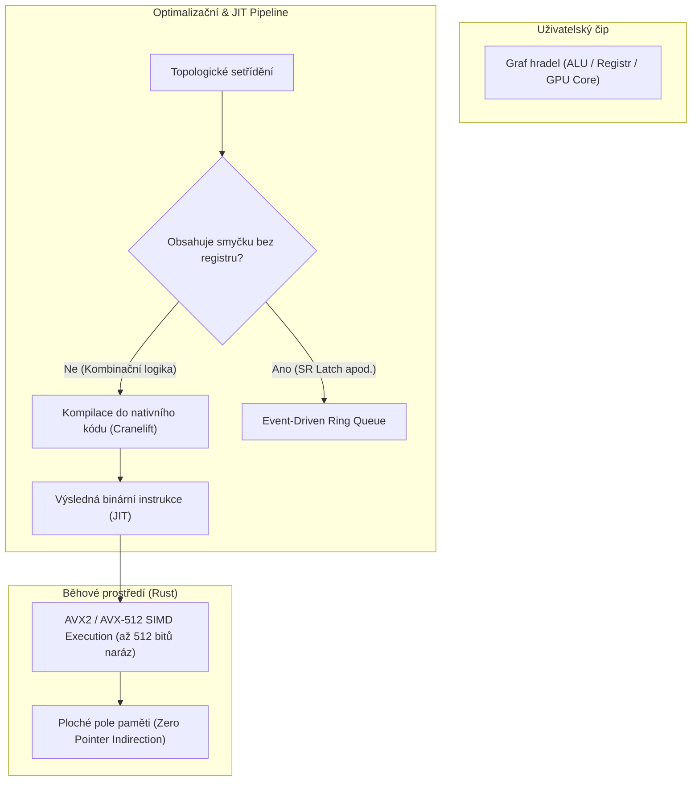

# SILICON // LOGIC STUDIO
### Architektonický plán & Technická specifikace hyper-výkonného simulátoru
> **Verze:** 1.0-PROPOSAL  
> **Autor konceptu:** Marian Vystavěl & Antigravity  
> **Cílová platforma:** Desktop (Windows / macOS / Linux via Tauri 2.0 + Rust + WebGPU)  
> **Estetika:** Editorial Brutalism × Cyber-Physical Silicon (Awwwards SOTD Tier)

---

```
   ┌────────────────────────────────────────────────────────────────────────┐
   │ [■] LOGIC VIEW               [ ] PHYSICS VIEW (SILICON DIE)   50.0 MHz │
   ├──────────────────────────────┬─────────────────────────────────────────┤
   │ 01010100 01100001 01101011   │  CHIP: ALU_32BIT_SIMD                   │
   │                              │  JIT STATE: NATIVE x86 COMPILED         │
   │  ┌──────┐       ┌────────┐   │  HEAT: 42.8°C [NORMAL]                  │
   │  │ CLK  ├───────┤ IP_REG │   │  VRAM: 320x240 @ 60 FPS (ZERO-COPY)     │
   │  └──────┘       └───┬────┘   ├─────────────────────────────────────────┤
   │                     │        │  [PROMPT]: "Vytvoř 16b barrel shifter   │
   │         ════════════╪════    │   z multiplexerů a otestuj přenos"      │
   │             DATA_BUS[31:0]   │  > AI: Generuji netlist & testbench...  │
   └──────────────────────────────┴─────────────────────────────────────────┘
```

---

## 1. Vizuální identita & Awwwards UX (Inspirace portfoliem)

Aplikace nesmí vypadat jako sterilní univerzitní software (Java Swing / Logisim). Přebírá **redakční brutalismus, technickou surovost a kinetickou haptiku** ověřenou na projektech Mariana Vystavěla (Three.js scény, WebGL fragment shadery, ASCII vrstvy, strojopisné detaily):

### 1.1 Typografie & Geometrie
- **Nadpisy & Akcenty:** *Outfit* (odtučněné i ultra-bold řezy, variabilní obrysy s `paint-order: stroke fill;`).
- **Kód, registry a sběrnice:** *JetBrains Mono* / *Courier New* (strojopis s ořezem a přísným `line-height: 1.4+` pro diakritiku).
- **Mřížka (Canvas Grid):** Nekonečné plátno s adaptivní mikro-mřížkou (sub-pixel grid rendering přes WebGPU fragment shader), která při zoomu plynule odhaluje sub-vrstvy až na úroveň atomární mřížky křemíku.

### 1.2 Barevná paleta (Dark Obsidian & Luminescent Silicon)
- **Podklad (`bg-base`):** `#07080A` (hluboká obsidiánová čerň s jemným šumem / grain).
- **Panelové plochy (`bg-surface`):** `#0E1116` s matným sklem (Glassmorphism, 1px linka `#1F242D`).
- **Signálová logika (Logic Colors):**
  - `Logická 1`: `#00F0FF` (elektrická neonová azurová s bloomem).
  - `Logická 0`: `#1A232E` (temně modro-šedá linka).
  - `High-Z (Plovoucí)`: `#FF8400` (varovná jantarová přerušovaná linka).
  - `Zkrat / Elektrický konflikt`: `#FF003C` (pulzující červené varování).
- **Fyzikální křemík (Physics Colors):**
  - Substrát Si: `#1E1B18` (grafitově zemitá).
  - Kov 1–4 (Alu/Cu): `#E6C280` (leštěná mosaz/zlato) & `#7098DA` (kovová modř).
  - Termální gradient: `#000022` $\to$ `#4B0082` $\to$ `#FF2200` $\to$ `#FFFF88` (bílé žároviště).

### 1.3 Kinetika & Haptický zvuk (WebAudio)
- **Taktilní odezva:** Každé přepnutí páčky, tlačítka nebo krokování generuje přes WebAudio syntetizér fyzikální zvuk sepnutí mechanického relé (krátký transient 2–4 ms, žádné generické MP3).
- **Zpětná vazba oscilátoru:** Při zrychlování systémových hodin z 10 Hz na 10 kHz se ozývá harmonické stoupání tónu (vysokofrekvenční bzučení napájecí kaskády à la cívky v reálných GPU).

---

## 2. Dva režimy: Logic View vs. Physics View

Uživatel se mezi pohledy přepíná klávesou `Tab` nebo plynulým prostorovým náklonem (2.5D tilt).

```
          [ TAB ]
LOGIC VIEW  ◄───►  PHYSICS VIEW
(Schéma)           (Křemíkový čip & Termo)
```

### A. Logic View (Symbolický & Sběrnicový)
- **Vektorové schéma:** Značky hradel (AND, OR, XOR, MUX, D-FF) podle ANSI/IEEE.
- **SDF Vodiče (Signed Distance Field):** Dráty jsou renderovány na GPU fragment shaderem – zůstávají absolutně ostré při jakémkoliv přiblížení.
- **Sběrnice (Buses):** Tlusté svazky (8/16/32/64 bitů) s číselným popisem v reálném čase.
- **Tunely (Net Labels):** Bezkabelové propojení (např. `CLK`, `RESET`, `DATA[0..31]`), které eliminuje změť drátů přes celou desku.

### B. Physics View (Křemíkový Die-Layout & Fyzika)
- **Vrstvený čip:** Uživatel vidí skutečný půdorys integrovaného obvodu:
  1. *Substrate layer* (P-Well, N-Well difuze).
  2. *Polysilicon layer* (hradla MOSFETů).
  3. *Metal 1 až Metal 4* (propojovací hliníkové/měděné cesty oddělené oxidem).
- **Parazitní RC zpoždění:** Delší drát má reálný odpor a kapacitu. Signál nedorazí okamžitě – uživatel vidí exponenciální náběhovou hranu ($1 - e^{-t/RC}$).
- **Termokamera v reálném čase:**
  - Každé sepnutí tranzistoru emituje energii $E = \frac{1}{2} C V^2$.
  - WebGPU Compute Shader počítá 2D difuzi tepla po křemíkové podložce. Přetaktovaná ALU bez chladiče se rozzáří do ruda a při překročení limitu začne generovat bitové chyby (thermal throttling / bit-flips).

---

## 3. Extrémní optimalizace simulace (Speed Tricks)

Aby simulátor utáhl **32bitový procesor + GPU vykreslující 320×240 na 60 FPS**, nemůže procházet uzly v grafu jako Logisim.



### Triky v kódu:
1. **JIT Kompilace sub-obvodů (Subcircuit Flattening):**
   - Složený čip (např. 16bitový Barrel Shifter složený ze stovek hradel) se přeloží do nativního procesorového kódu x86-64/ARM64:
     ```rust
     // Namísto simulace stovek logických hradel:
     #[inline(always)]
     pub fn simulate_barrel_shifter(val: u32, shift: u8) -> u32 {
         val.rotate_left(shift as u32)
     }
     ```
2. **Bit-Slicing (SIMD paralelismus):**
   - V jednom taktu hostitelského CPU simulujeme **64 až 256 instancí identických obvodů** (např. 64 shader jader virtuální grafiky počítá 64 pixelů naráz).
3. **Data-Oriented SoA (Structure of Arrays):**
   - Paměťový model bez ukazatelů. Žádné `Node*`, ale flat buffery `wire_states: Vec<u64>`. CPU cache L1/L2 má 100% zásahovost.
4. **Zero-Copy VRAM Texture Binding:**
   - Dvouportová VRAM virtuálního GPU je přímo namapována do textury WebGPU. Virtuální GPU zapisuje bajty, shader monitoru je bez kopírování v témže rámci vykresluje.

---

## 4. Systémová architektura: Počítač (CPU + GPU)

### 4.1 Sekvenční prvky a časování
- **Master Clock:** 1 Hz až 50 MHz (v JIT režimu). Tlačítka `Step (1 cyklus)`, `Half-Step`, `Run/Pause`.
- **D Flip-Flop a Registry:** 1, 8, 16, 32 bitů. Vstupy: `Data`, `CLK`, `Write Enable`, `Clear`.
- **RAM a ROM bloky:** Rychlá černá skříňka `Box<[u8]>`.
  - ROM má přímé napojení na integrovaný Assembler.
  - RAM podporuje hexadecimální live-view s editací za běhu.

### 4.2 Sběrnice a propojování
- **Sběrnice (Buses):** 8/16/32/64 bit. Automatická kontrola bitové šířky při napojení.
- **Splitter / Merger:** Rozdělení sběrnice na jednotlivé dráty a zpětné sloučení.
- **Multiplexory & Demultiplexory (MUX/DEMUX):** 1-bit i sběrnicové varianty.
- **Tri-State Buffery:** Stavy `0`, `1`, `Z` (High-Impedance). Umožňuje sdílenou datovou sběrnici bez zkratu.

### 4.3 GPU & Grafický subsystém
- **Virtuální monitor (Display Engine):**
  - Nastavitelné rozlišení: `64×64` (retro/pixel), `160×120`, `320×240`.
  - Režimy: 1bit monochromatický, 8bit indexed (paleta), RGB565.
  - V-Sync a H-Sync signály generované displejem jako hardwarová přerušení pro CPU/GPU.
- **Dual-Port VRAM:** Port A pro rasterizér GPU, Port B pro pixelový skener obrazovky.
- **SIMD Shader Cores:** Šablona pro skládání 8 až 64 paralelních výpočetních jednotek pracujících synchronně nad různými daty.
- **Předpřipravené aritmetické akcelerátory:** Volitelné bloky pro rychlou grafiku:
  - HW Násobička (Multiplier).
  - Barrel Shifter (hardwarový rotátor).
  - Plovoucí řádová čárka (Half-Precision FPU).

### 4.4 CPU $\leftrightarrow$ GPU komunikace
- **Memory-Mapped I/O (MMIO):** Adresový dekodér přeposílá zápisy procesoru na vybraných adresách (`0xF000..0xFFFF`) přímo do řídicích registrů GPU.
- **DMA Controller:** Blok schopný samostatně zkopírovat blok dat z RAM do VRAM na pozadí a po dokončení vyvolat IRQ.
- **Interrupt Controller (Přerušení):** Linky pro V-Sync (nový snímek), systémový časovač a klávesnici.

---

## 5. Vývojářské prostředí & Tooling

```
┌─────────────────────────────────────────────────────────────────────────────┐
│  ASM EDITOR (Monaco)              │  WAVEFORM ANALYZER                      │
│                                   │                                         │
│  01: ; Vykresli trojúhelník       │  CLK   _П_П_П_П_П_П_П_П_П_П_П_П_П_П_П   │
│  02: MOV R1, #0xF000  ; GPU_CMD   │  BUS   [ 0x00 ] [ 0xF000 ] [ 0x0001 ]   │
│  03: MOV R2, #1       ; DRAW_TRI  │  WE    _______/‾‾‾‾‾‾‾\____________     │
│  04: STR R2, [R1]                 │  IRQ   ________________________/‾‾‾     │
│  ► CURRENT PC: 0x0004 [STR]       │  [T = 142.4 μs] [Zoom: 100ns/div]       │
└───────────────────────────────────┴─────────────────────────────────────────┘
```

1. **Custom ISA Editor:**
   - Uživatel si definuje vlastní instrukce v přehledném JSON/YAML formátu (Mnemonic $\to$ Opcode $\to$ Bitová maska operandů).
2. **Integrovaný Assembler & Live Debugger:**
   - Psaní kódu v assembleru přímo v aplikaci.
   - Tlačítko **Compile & Flash to ROM**: Okamžité naplnění paměti strojovým kódem.
   - Synchronní krokování: Při běhu procesoru se v assembleru barevně posouvá ukazatel aktuální instrukce (Program Counter).
3. **Logický analyzátor (Waveform Oscilloscope):**
   - Výsuvný spodní dok (inspirovaný Hamzas-Desk).
   - Záznam průběhu vybraných signálů v čase takt po taktu s možností měření zpoždění a hledání náběžných/sestupných hran.
4. **Hex/Dec Sondy a 7-Segmentové Displeje:**
   - Možnost kamkoliv na sběrnici připíchnout plovoucí bublinu zobrazující hodnotu v Hex, Dec, Bin nebo jako ASCII znak.

---

## 6. AI Komponentový Copilot

AI asistent je integrován přímo do plátna formou inteligentního návrháře:

1. **Prompt-to-Netlist:**
   - Zadání: *"Vytvoř 8bitovou sčítačku s predikcí přenosu (Carry-Lookahead) z mých existujících 1bitových bloků."*
   - AI vygeneruje validní schéma ve standardizovaném formátu **JSON Netlist**.
2. **Auto-Routing & Collision Avoidance:**
   - Algoritmus A* pro pravoúhlé vedení vodičů bez zbytečného křížení a překrývání čipů.
3. **Automatický Testbench & Verifikace:**
   - Než AI čip vloží na plátno, simulační jádro ho v pozadí otestuje proti matematickému modelu (projede všechny vstupy 0–255 a ověří výsledky). Pokud čip selže, AI jej samo opraví.
4. **AI Asistent pro Assembler:**
   - Prompt: *"Napiš v mém assembleru kód, který vykreslí skákající míček (Bouncing Ball) na obrazovku 64×64."*

---

## 7. Technologický Stack

| Komponenta | Technologie | Důvod volby |
| :--- | :--- | :--- |
| **Desktop Shell** | **Tauri 2.0 (Rust)** | Nativní rychlost, nulový overhead, bezpečnost, binárka do 20 MB |
| **Simulační jádro** | **Rust + Cranelift JIT** | Paralelní běh na všech jádrech CPU, SIMD instrukce (AVX-512), blesková kompilace |
| **Canvas & Render** | **WebGPU + wgpu / PixiJS** | Hardware akcelerovaný SDF rendering vodičů, neonový bloom shader, 144+ FPS |
| **UI Vrstva** | **Svelte 5 / React Flow + Tailwind** | Okamžité reakce UI, žádný virtual DOM overhead (Svelte runes), špičková estetika |
| **Editor kódu** | **Monaco Editor (VS Code core)** | Profesionální syntax highlighting, doplňování kódu pro assembler |
| **Zvukový engine** | **WebAudio API (DSP syntéza)** | Generování fyzikálních zvuků relé a oscilátorů v reálném čase bez zpoždění |
| **AI Integrace** | **Gemini 2.5 Flash / Claude API** | Vysoká rychlost strukturovaného výstupu (JSON Schema) pro generování obvodů |

---

## 8. Harmonogram realizace (Roadmapa)

- [ ] **Milník 1: Simulační jádro v Rustu & WebGPU Canvas**
  - Implementace SoA paměťového modelu a základních hradel (NAND, NOR, AND, OR, XOR, NOT).
  - WebGPU plátno s nekonečným zoomem a SDF vykreslováním vodičů s neonovým bloomem.
- [ ] **Milník 2: Sekvenční obvody & Sběrnice**
  - Hodiny, D-Flip-Flop, registry, vícebitové sběrnice, splittery a tri-state buffery.
- [ ] **Milník 3: Hierarchie, Blackboxing & JIT kompilace**
  - Funkce "Zabalit obvod do čipu", export/import komponent, JIT kompilace do nativního kódu.
- [ ] **Milník 4: Physics View & Termodynamika**
  - Zobrazení fotolitografických křemíkových vrstev a WebGPU compute shader pro difuzi tepla.
- [ ] **Milník 5: GPU monitor, Assembler & AI Copilot**
  - Dual-Port VRAM displej, Custom ISA Editor s Monaco Assemblerem, integrace AI pro generování a verifikaci obvodů.
